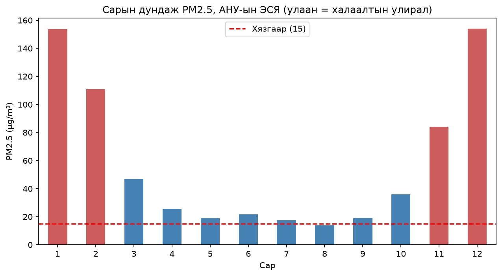
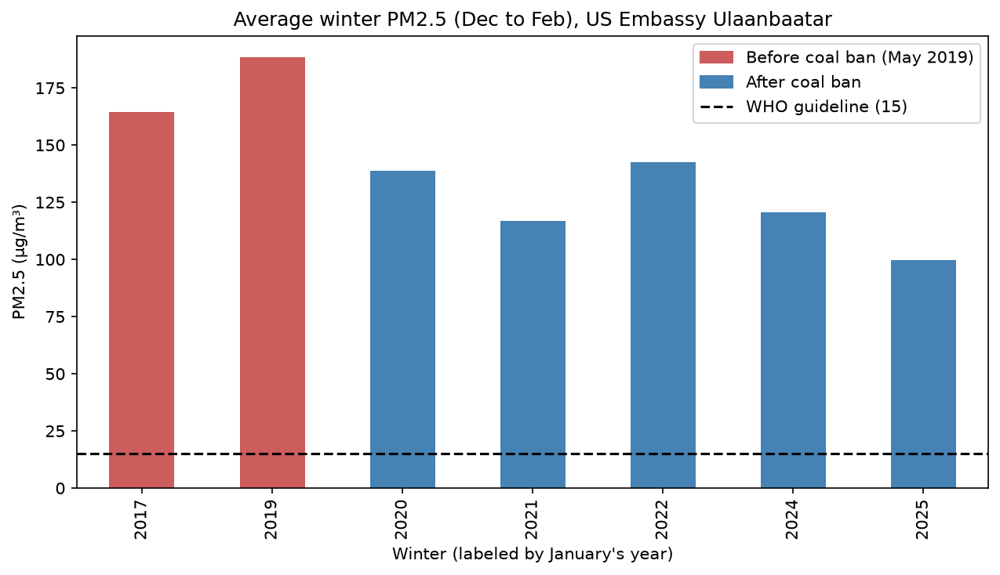
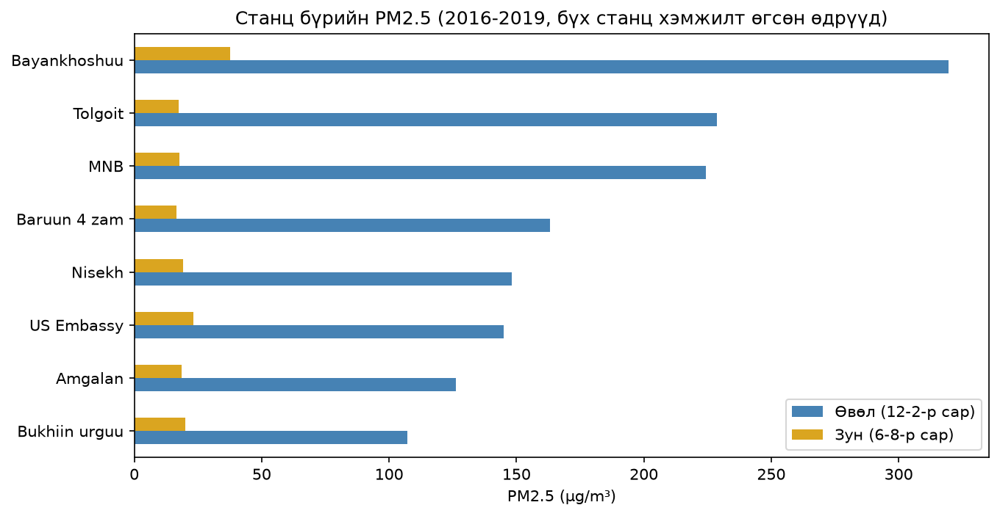
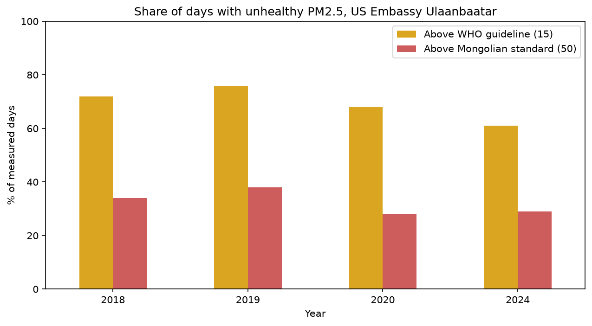

[English](README.en.md) · **Монгол**

# Улаанбаатарын агаар: PM2.5-ын 9 жилийн өгөгдөл

[OpenAQ API](https://openaq.org)-ийн бодит мэдрэгчийн өгөгдлөөр Улаанбаатарын агаарын бохирдлыг шинжилсэн төсөл. Улирлын ялгаа, 2019 оны 5-р сарын түүхий нүүрсний хориг, дүүргүүдийн ялгаа, жилд хэдэн өдөр агаар эрүүл бус байдгийг судалсан.

> **Гол дүгнэлт: дээрдсэн ч аюулгүй биш.** 2019 оны нүүрсний хоригийн дараа өвөл 30% орчим цэвэр болсон ч ихэнх өдөр PM2.5 ДЭМБ-ын зөвлөмжөөс хол дээр хэвээр байна.

## Нэр томьёо

| Нэр томьёо | Утга |
|---|---|
| **PM2.5** | 2.5 микрометр ба түүнээс жижиг утаа, тоосны тоосонцор. Уушгины гүнд хүрдэг. |
| **µg/m³** | Нэг шоо метр агаар дахь тоосонцрын микрограмм |
| **ДЭМБ-ын зөвлөмж** | 24 цагийн дундаж 15 µg/m³ (Дэлхийн эрүүл мэндийн байгууллага, 2021) |
| **Монголын стандарт** | 24 цагийн дундаж 50 µg/m³ (MNS 4585:2016) |

## Судалгааны асуултууд

1. **Улирал:** Өвлийн агаар зунаас хэр их бохир вэ?
2. **Нүүрсний хориг:** 2019 оны 5-р сарын түүхий нүүрсний хоригийн дараа өвөл цэвэр болсон уу?
3. **Дүүргүүд:** Хотын аль хэсэг хамгийн бохир агаартай байсан бэ?
4. **Эрүүл мэнд:** Жилд хэдэн өдөр агаар эрүүл бус байдаг вэ?

## Дүгнэлтүүд

### 1. Өвлийн агаар зунаас 8 орчим дахин бохир

12, 1-р сарын дундаж **154 µg/m³** (ДЭМБ-ын зөвлөмжөөс 10 орчим дахин их). 5-9-р сарын дундаж **18.5**.



### 2. Нүүрсний хоригийн дараа өвөл 30% орчим цэвэр болсон

| Үе | Өвлүүд | Өвлийн дундаж PM2.5 (12-2-р сар) |
|---|---|---|
| Хоригоос өмнө | 2016-17, 2018-19 | **176.4** |
| Хоригийн дараа | 2019-20-оос 2024-25 (5 өвөл) | **123.7** |

Хоригийн дараах өвөл бүр өмнөх хоёр өвлөөс доогуур байсан. Энэ нь УБ-ын төвийн станцад 2019-20 оны өвөл PM2.5 44% орчим буурсныг тогтоосон нийтлэгдсэн судалгаатай ижил чиглэлтэй.



**Энэ нь холбоог харуулж байгаа болохоос шалтгааныг батлахгүй.** Бууралтын зарим хэсгийг өөр хүчин зүйл тайлбарлаж болно:
- Хоригоос өмнөх ашиглах боломжтой ердөө 2 өвөл
- Цаг агаар (хүйтэн өвөл илүү их түлж, урвуу дулаан хүчтэй болдог)
- 2020-21 оны COVID-19-ийн хөл хорио
- Ганц станц

### 3. Зарим хэсгийн өвлийн агаар 3 дахин бохир

8 станц бүгд хэмжилт өгсөн 221 өдрийн өгөгдлөөр өвлийн PM2.5 **107**-оос (Бөхийн өргөө) **320** (Баянхошуу) хүртэл хэлбэлзсэн. Зун 8 станцын 7 нь 17-23 хооронд байсан. Өвлийн их зөрүү нь хот даяарх замын хөдөлгөөнөөс илүү орон нутгийн халаалтыг заана.



### 4. Ихэнх өдөр эрүүл бус, жил бүр

| Он | ДЭМБ-аас (15) дээш өдөр | MNS-аас (50) дээш өдөр | Хамгийн муу өдөр |
|---|---|---|---|
| 2018 | 72% | 34% | 366 |
| 2019 | 76% | 38% | 472 |
| 2020 | 68% | 28% | 285 |
| 2024 | 61% | 29% | 270 |

Хамгийн цэвэр жил болох 2024 онд ч **өдрийн 5-аас 3 нь** ДЭМБ-ын зөвлөмжөөс дээш байсан.



## Өгөгдөл

| Бүлэг | Станц | Он | Ашигласан |
|---|---|---|---|
| A | АНУ-ын ЭСЯ (нэг төхөөрөмж, OpenAQ дээр 2016.11-д нэр нь солигдсон) | 2016-2025 | Улирал, нүүрсний хориг, эрүүл мэнд |
| B | Засгийн газрын 7 станц: МҮОНРТ (MNB), Амгалан, Бөхийн өргөө, Баруун 4 зам, Нисэх, Толгойт, Баянхошуу | 2016-2019 | Дүүргүүдийг харьцуулах |
| C | Бөмбөгөр | 2025.11-өөс одоо | Сүүлийн өвөл (зөвхөн урьдчилсан) |

Өдрийн дунджийг OpenAQ v3-ийн `/sensors/{id}/days` endpoint-оос татсан: **10,174 өдрийн мөр**.

## Өгөгдлийн чанарын дүрэм

1. **Зөвхөн бүрэн өдрүүд:** цагийн хэмжилтийн 75%-иас доошгүйтэй өдрүүдийг үлдээв (10,174-өөс 7,597 мөр).
2. **Зөвхөн бүрэн өвлүүд:** 12, 1, 2-р сар тус бүр 15+ сайн өдөртэй бол л тэр өвлийг тооцов. 2017-18, 2022-23 оны өвөл хасагдсан.
3. **Сэжигтэй үеийг хасав:** АНУ-ын ЭСЯ-ны 2021 оны 3-10-р сарын хэмжилт бусад бүх жилийн ижил сараас 3-4 дахин өндөр, харин эргэн тойрны өвлийн сарууд хэвийн байсан. Энэ нь мэдрэгчийн алдаа байх магадлалтай тул эдгээр 164 өдрийг хассан (7,433 мөр үлдсэн).

## Нээлттэй асуултууд

- Хоригийн дараах бууралтын хэдэн хувь нь цаг агаараас шалтгаалсныг шалгахын тулд өдрийн температурын өгөгдөл нэмэх
- Цагийн өгөгдлөөр өдрийн хамгийн муу цагийг олох
- Бөмбөгөр 2025 оны 12-р сараас 2026 оны 2-р сард дунджаар 49 µg/m³ байсан ч өөр байршилд байгаа өөр мэдрэгч тул шууд харьцуулах боломжгүй
- Баянхошуу зун ч бусад станцаас 2 орчим дахин их байсан. Тоос уу, зам уу, үйлдвэр үү?

## Төслийн бүтэц

```
Air_Pollution/
├── src/
│   ├── find_stations.py      # Улаанбаатарын PM2.5 мэдрэгчүүдийг олох
│   └── download_daily.py     # өдрийн дунджийг data/ руу татах
├── notebooks/
│   └── 01_clean_explore.ipynb  # цэвэрлэгээ, шинжилгээ, график
├── data/                     # түүхий ба цэвэрлэсэн CSV
├── figures/                  # хадгалсан графикууд
└── requirements.txt
```

## Хэрхэн ажиллуулах вэ

1. [explore.openaq.org](https://explore.openaq.org)-оос үнэгүй API түлхүүр аваарай.
2. Төслийн хавтаст `.env` файл үүсгэнэ (git үүнийг хянахгүй):
   ```
   OPENAQ_API_KEY=your-key-here
   ```
3. Python орчноо бэлдэнэ:
   ```bash
   python3 -m venv .venv
   source .venv/bin/activate
   pip install -r requirements.txt
   ```
4. Скриптүүдийг ажиллуулаад notebook-оо нээнэ:
   ```bash
   python src/find_stations.py
   python src/download_daily.py
   ```
   `notebooks/01_clean_explore.ipynb`-г нээгээд **Run All** дарна.

## Эх сурвалж

- [OpenAQ API v3 баримт бичиг](https://docs.openaq.org)
- ДЭМБ, Агаарын чанарын дэлхийн удирдамж (2021)
- [Монгол Улсын стандарт MNS 4585:2016 (UNEP LEAP)](https://leap.unep.org/en/countries/mn/national-legislation/mongolia-standard-mns-45852016)
- [Particulate matter concentrations during winter seasons of 2016-2020 in Ulaanbaatar, Mongolia (Монголын ШУА-ийн Мэдээ)](https://www.mongoliajol.info/index.php/PMAS/article/view/1559)

---
AI Academy-ийн төсөл болгон Оргил хийв.
